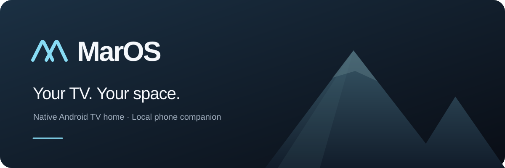
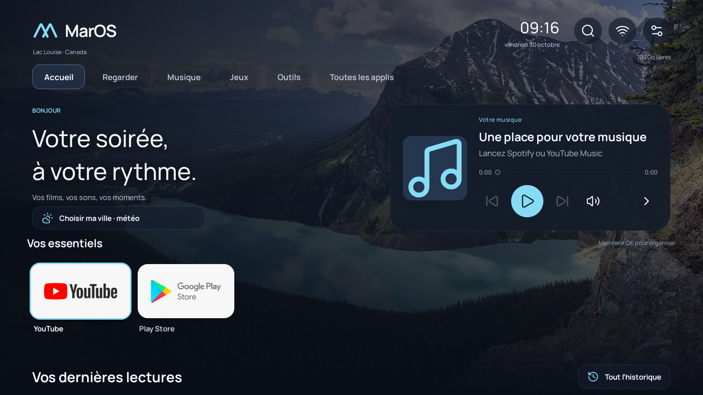

<p align="center"></p>

<p align="center">
  <a href="https://github.com/Marouane4142/MarOS/releases"></a>
  <a href="https://github.com/Marouane4142/MarOS/actions/workflows/ci.yml"></a>
  <a href="LICENSE"></a>
  
  
</p>

**A personal home for Android TV and Google TV.** Native, remote-friendly, and free of advertising in the launcher. Your apps, your landscapes, your music — with a local phone companion.

[Français](docs/README.fr.md) · [Download](https://github.com/Marouane4142/MarOS/releases) · [Installation](docs/INSTALLATION.md) · [Contributing](CONTRIBUTING.md)

## Preview



Actual clean-install Android TV emulator capture. Available favorites depend on installed apps; no personal accounts or viewing data are shown. [Settings preview](docs/assets/settings.png) · [Screenshot and backdrop credits](docs/assets/README.md).

## What you get

- **Your essentials:** ordered favorites, app collections, hidden apps, custom banners and a shortcut to the installed Play Store.
- **A quieter home:** Nature, Cinema and Minimal presets, rotating landscapes, a personal album and ambient mode.
- **Real media controls:** artwork, track information, playback and seeking through compatible Android media sessions.
- **Recent viewing:** chronological, usable Watch Next entries and observed video sessions. No invented universal streaming history.
- **Your phone as a companion:** scan a QR code, send photos, edit favorites, prepare searches, keep shortcuts and export preferences. No phone app or central server required.
- **Useful extras:** opt-in city weather, a local agenda and timer. Optional Jellyfin, Home Assistant, Wake-on-LAN, camera and Ollama-compatible connectors.
- **Reversible installation tools:** explicit ADB device selection, a configuration snapshot and a journal of changes. Packages are disabled rather than uninstalled.

## First public beta

**v4.0.0-beta.1** is the first public MarOS release, derived from the private 4.0 iteration. The Android package is `io.github.marouane4142.maros`. Android **11 / API 30** is the minimum; the current target SDK is also 30.

The predecessor was exercised on a Xiaomi TV Box S 2nd generation running Android 11. This public package has its own release signature and is an early beta: other remotes, manufacturers and Android versions need testing. The interface is currently primarily **French**. See [validation and limitations](docs/TESTING.md).

An APK installs the launcher. It does **not** silently disable manufacturer applications, enable special access, or remove advertising inside third-party streaming apps.

## Install

Download the APK and `SHA256SUMS.txt` from [Releases](https://github.com/Marouane4142/MarOS/releases). Follow [the backup-first installation guide](docs/INSTALLATION.md) to install it, test it and select it as HOME. Manufacturer cleanup is optional and model-dependent.

This public package is separate from the earlier private `com.mihir.tvhome` installation. It does not overwrite that app or automatically migrate its data.

## Build from source

Requirements: Python 3.10+, JDK 11+, Android SDK platform and Build-Tools. A known CI configuration uses JDK 17, platform 34 and Build-Tools 34.0.0.

```sh
git clone https://github.com/Marouane4142/MarOS.git
cd MarOS
python launcher/build.py --sdk /path/to/Android/Sdk
```

On Windows, `python launcher/build.py --sdk "C:\path\to\Android\Sdk"` works too. Set `JAVA_HOME`, or pass `--java-home`. The result is `launcher/build/MarOS-debug.apk`, signed with an ignored local debug key. This command never connects to a TV.

The build uses `aapt2`, `javac`, D8, `zipalign` and `apksigner` directly, without Gradle. It verifies signing, ZIP paths and the twelve bundled JPEGs. Official releases use a separate private key; see [releasing](docs/RELEASING.md). A local debug APK cannot update an official release signed with another key.

```sh
python tools/check.py
```

Checks include Python/XML validation and the existing 17 chronology assertions. CI builds a debug artifact; official release APKs are separately signed.

## Phone companion and privacy

Open **Mon téléphone** on the TV. Scan its QR code or enter the displayed HTTP address and six-digit code. The session stays active for one hour across app changes and can be closed immediately on the TV.

The companion uses **HTTP on your local network**, not encrypted transport. Use a trusted LAN; do not forward port 8765 to the Internet. The APIs require pairing and validate request origins, formats and sizes.

Preferences, viewing observations and imported images remain in the app's private storage. Integration credentials use Android Keystore-backed encryption and are excluded from portable settings exports. Weather sends a user-chosen city and its coordinates to Open-Meteo; no weather location is preset and no forecast is requested before configuration. External services are contacted when you use their features. Read [privacy](PRIVACY.md) and [security](SECURITY.md).

## How it is organized

```text
launcher/src/io/github/marouane4142/maros/  Native TV app and local server
launcher/src/io/nayuki/qrcodegen/          Vendored QR generator
launcher/assets/companion.html            Phone interface
launcher/res/                             Android resources and vector icons
launcher/build.py                         Portable APK build
tools/tv-session.py                       Checked, journaled ADB operations
docs/                                    Installation, architecture and release notes
```

The TV interface is native Java views, not a WebView. It does not need an AI model. Notification-listener access supports media sessions; accessibility access supports selected remote buttons. These optional permissions must be deliberately enabled. See [architecture](docs/ARCHITECTURE.md).

## Limitations

Streaming apps decide what metadata, history and deep links they expose. Netflix, Prime Video, TiviMate and others may not share complete or current viewing information. MarOS cannot bypass these restrictions. Chromecast, voice, DRM playback, casting routes and every remote revision are not guaranteed by this beta.

Jellyfin, Home Assistant, Wake-on-LAN, cameras and the optional assistant require your own compatible devices or servers. Their setup screens are not a claim of hardware certification. The local agenda does not synchronize an external calendar. MarOS is not affiliated with Google, Xiaomi or any streaming service.

## Credits and license

MarOS builds on **[mihirgupta0900/tv-home](https://github.com/mihirgupta0900/tv-home)**, at base commit `19803542cd335e0b2643dfa73c18c38051354ffa`. The upstream MIT notice is retained; MarOS contributions are also MIT. See [LICENSE](LICENSE) and [provenance](docs/upstream.json).

Third-party assets retain their own licenses: Lucide (ISC / applicable Feather MIT notices), Manrope (SIL OFL 1.1), Nayuki QR generator (MIT), and Wikimedia landscapes (their individual CC BY-SA licenses). See [third-party notices](THIRD_PARTY_NOTICES.md) and [wallpaper credits](launcher/WALLPAPER-CREDITS.md). The banner above is a brand illustration, not a device screenshot.
