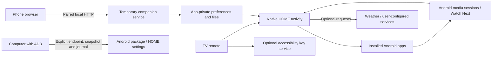

# Architecture

MarOS is one native Android APK plus host-side installation tools. The phone UI is served by the TV; there is no required MarOS cloud service.

## Native UI

`MainActivity.kt` owns one persistent Compose HOME. `HomeViewModel` uses lifecycle-aware StateFlow and cancellable coroutines; app enumeration is separate from data refresh. `HomeScreen`, `Design`, `HomeLayout` and `Profiles` live under `tv/`. Studio is a Compose TV control room. Existing Java detailed editors and Android services remain compatible through LauncherPrefs.

Compose TV Material supplies controls/focus semantics; Material 3 Expressive supplies motion specifications without installing a mobile MaterialTheme. Manrope, vector icons and twelve landscapes remain local assets. Lazy shelves/grids create visible items. Application artwork has an 8 MiB cache and an image-specific revision; photo previews are paged in the Java editor. UI labels remain primarily French and localization is still incomplete.

## Media and viewing

`MediaBridge` and `MusicPanelView` use `MediaSessionManager` and `MediaController`. Notification-listener access supplies authorization to enumerate sessions. `MediaListener` does not process notification text; it observes compatible video sessions. `PlaybackHistory`, `ContentBridge` and `RecentPolicy` combine supported observations with usable continuation entries. A launch is kept distinct from watching a video. Source applications control their metadata, history freshness, resume URIs and media actions.

`RemoteButtonService` uses explicitly enabled accessibility key filtering. It does not request window content. Only selected dedicated keys and calibration are handled. `AmbientActivity` / `AmbientDreamService` supply photo presentation. A timer uses Android alarm/notification APIs. The agenda combines local/ICS entries with explicitly selected Android Calendar instances after runtime permission.

## Companion

`CompanionService` is a deliberately started foreground service with a close action and a one-hour deadline. It has no boot receiver or wake lock. `CompanionServer` uses a bounded, small Java socket server and serves `assets/companion.html`. Pairing yields a temporary token; Host/Origin, input types, size bounds and pairing attempts are checked. The browser keeps its token in sessionStorage. The QR code includes the address and pairing code in a URL fragment, not in an HTTP request query.

The service is **trusted-LAN HTTP**, not encrypted transport or Internet hosting. A suspended device may be unreachable. After an IP change, close/reopen the session. The browser can reconnect when a new QR fragment is received in an already open page.

## Data and integrations

Preferences and local observations use SharedPreferences; imported images use the app's private files directory. Portable settings are restricted to an explicit allowlist. Integration tokens use AES-GCM with Android Keystore. Optional networking uses bounded worker tasks and HttpURLConnection. Weather has no default location; a user-entered query is resolved through Open-Meteo/GeoNames before the forecast request. Other services require user-provided addresses/credentials.

`ProfileActivity` selects Google-linked identities and the guest session. `StudioActivity` exposes three daily settings categories. `ExperienceActivity` now renders individual content/actions such as the watchlist and backups, without a global feature settings sidebar. `RoomData` exposes a finite set of semantic phone actions; directional events reach only the visible MarOS window. `RoomTasks` acknowledges long operations immediately and retains bounded polling results. Voice recognition is handled by the existing system Google app; MarOS has no microphone, dictation or voice parser. `Watchlist` holds chosen titles separately from playback observations and optionally queries TVmaze. `MaintenanceJob` performs opt-in six-hour idle/unmetered work, with no permanent polling service.

`DeviceAccounts` uses Android's account picker to grant visibility to a chosen existing Google account. On firmwares whose Google picker requires an unavailable stock launcher, it keeps the same chooser extras and uses the exported Android platform chooser if present. No system password or token is read and no Google auth SDK is bundled. `UserAccounts` stores the selected address and a local label separately from settings exports; it reuses profiles on exact Google account matches. Calendar access is requested separately and checks account visibility for native associations. Guest mode masks personal feeds. Native selection provides no Google profile photo or verified cloud identity.

`GoogleLink` implements Google's optional HTTPS limited-input device flow for Drive backups. Client configuration and tokens stay in encrypted local storage. Scopes are identity and `drive.file`; Calendar uses the Android provider instead. OAuth upgrades a matching native profile when Google verifies the same email address. Drive archives are app-tagged and uploaded as streamed resumable requests. `PersonalBackup` validates a finite ZIP format, image dimensions, settings types, quotas and entry names before merging, and keeps a private previous-state archive. Credentials never enter ZIP exports.

## Build and tools

`launcher/build.py` drives the pinned Gradle wrapper and verifies the resulting APK. Kotlin/Compose uses AGP built-in Kotlin. Release builds enable R8/resource shrinking and merge library Baseline Profiles. Local debug signing material stays under ignored `.local/`; official signing requires an external keystore and password environment variables. The build never contacts a TV. See [MarOS 5](MIGRATION-5.md) for versions, new connectors and remaining migration boundaries.

`tools/tv-session.py` is a separate standard-library Python ADB wrapper. Device selection is mandatory. Snapshots and journals stay on the user's computer. The new public package is `io.github.marouane4142.maros`; upstream provenance is retained in the license and `upstream.json`.

`UserAccounts` binds Google display identity and bounded private avatars to launcher profiles; encrypted OAuth tokens are keyed separately per profile. `CalendarAccess` automatically matches visible/synchronized Google provider rows to the active identity's email. No arbitrary calendar IDs or account fallbacks are used. Google device-code cancellation is generation-checked before the code or credentials are committed.

`HomeNavigation` animates one focus rectangle behind stable tabs. The horizontal bring-into-view policy only scrolls at the edges. App/episode focus scaling and view entrances read animated values inside graphics/draw phases; the static backdrop remains cached separately.
