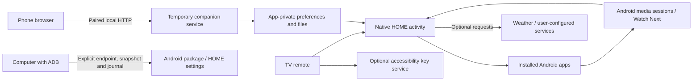

# Architecture

MarOS is one native Android APK plus host-side installation tools. The phone UI is served by the TV; there is no required MarOS cloud service.

## Native UI

`MainActivity` provides HOME and app collections. `MarOSUI` contains shared native views, focus behavior, font caches and centered icon rendering. `IconRegistry` maps controls to Android vector resources. `SettingsActivity` exposes common tasks first and advanced controls separately; `HubActivity` provides the optional tools.

The TV UI is composed from Android Views and Drawables in Java 11. It does not embed a web runtime. Manrope, icons and twelve landscapes are local assets. Some labels are resources, but much of the current UI is still French text in Java; localization is an open contribution area.

## Media and viewing

`MediaBridge` and `MusicPanelView` use `MediaSessionManager` and `MediaController`. Notification-listener access supplies authorization to enumerate sessions. `MediaListener` does not process notification text; it observes compatible video sessions. `PlaybackHistory`, `ContentBridge` and `RecentPolicy` combine supported observations with usable continuation entries. A launch is kept distinct from watching a video. Source applications control their metadata, history freshness, resume URIs and media actions.

`RemoteButtonService` uses explicitly enabled accessibility key filtering. It does not request window content. Only selected dedicated keys and calibration are handled. `AmbientActivity` / `AmbientDreamService` supply photo presentation. A timer uses Android alarm/notification APIs; the agenda remains local.

## Companion

`CompanionService` is a deliberately started foreground service with a close action and a one-hour deadline. It has no boot receiver or wake lock. `CompanionServer` uses a bounded, small Java socket server and serves `assets/companion.html`. Pairing yields a temporary token; Host/Origin, input types, size bounds and pairing attempts are checked. The browser keeps its token in sessionStorage. The QR code includes the address and pairing code in a URL fragment, not in an HTTP request query.

The service is **trusted-LAN HTTP**, not encrypted transport or Internet hosting. A suspended device may be unreachable. After an IP change, close/reopen the session. The browser can reconnect when a new QR fragment is received in an already open page.

## Data and integrations

Preferences and local observations use SharedPreferences; imported images use the app's private files directory. Portable settings are restricted to an explicit allowlist. Integration tokens use AES-GCM with Android Keystore. Optional networking uses bounded worker tasks and HttpURLConnection. Weather has no default location; a user-entered query is resolved through Open-Meteo/GeoNames before the forecast request. Other services require user-provided addresses/credentials.

## Build and tools

`launcher/build.py` drives SDK tools directly: aapt2 → javac → D8 → ZIP normalization → zipalign → apksigner → archive/signature checks. Local debug signing material is generated only under ignored `.local/`. Release signing requires an existing external keystore and password environment variables. The build does not use Gradle or contact a TV.

`tools/tv-session.py` is a separate standard-library Python ADB wrapper. Device selection is mandatory. Snapshots and journals stay on the user's computer. The new public package is `io.github.marouane4142.maros`; upstream provenance is retained in the license and `upstream.json`.
